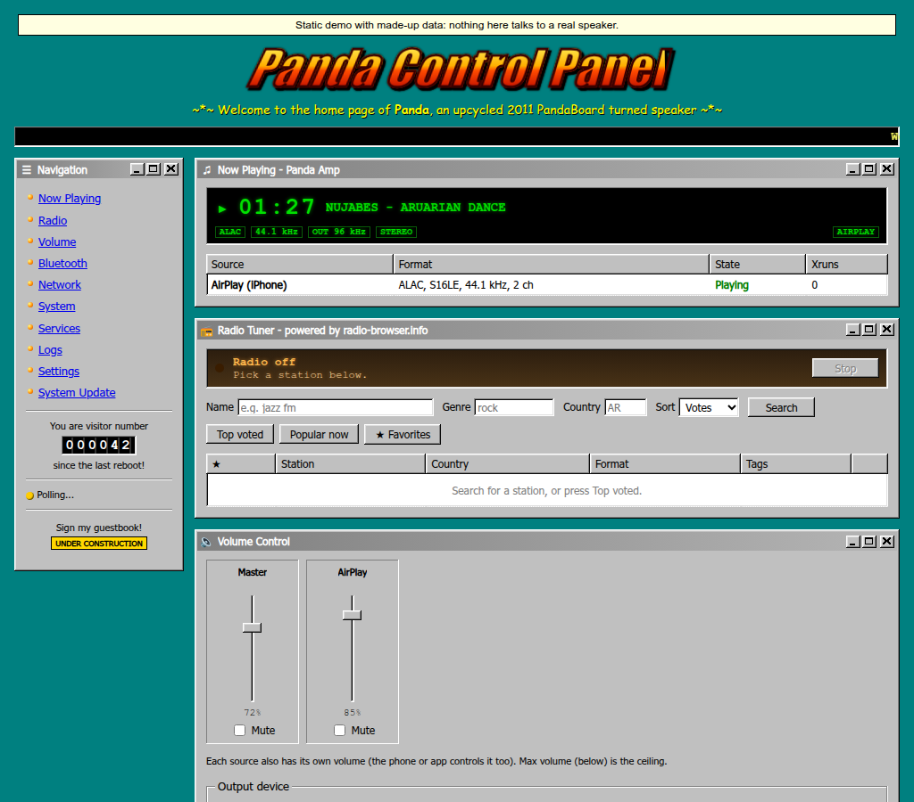

# Audio appliance

A network speaker for old ARM boards: a small Linux distribution based on Alpine
Linux. It plays Spotify Connect, AirPlay, Bluetooth and internet radio through the
board's headphone jack or a USB DAC, and you control it from a web page. The
system is a read-only image on the SD card and everything it writes goes to RAM,
so you can pull the plug at any time.

## Features

Sources:

- Spotify Connect, with Spotify's official client (Soloist). It shows up in the
  Spotify app on the same network. The speaker downloads Soloist from Spotify and
  keeps it up to date on its own.
- AirPlay, from iPhones, Macs and Linux desktops (PipeWire's RAOP sink).
- Bluetooth A2DP. Pair with the button or the web page; it reconnects to the last
  phone on its own.
- Internet radio, tuned from the web page.
- A new stream pauses the one that was playing, so sources don't overlap.

Sound:

- One fixed output rate (96 kHz / 32-bit on the PandaBoard codec). Everything is
  resampled to it, so every source takes the same path.
- Output to the 3.5 mm jack or any USB audio device.
- Bass and treble with headroom so boosting doesn't clip.
- A volume cap and a fixed startup volume. One volume for all sources, synced with
  Bluetooth, Spotify and AirPlay.

System:

- Settings survive power cuts.
- Updates go into a second slot and boot on trial. If the new version fails, the
  board falls back to the old one.
- Wi-Fi (many USB dongles) or Ethernet, a firewall limited to the local network, a
  hardware watchdog and a factory-reset button.
- Chimes for boot, pairing and connect/disconnect. No speech.
- On boards with a small TFT, a front panel with a live spectrum.

## Web control panel

The speaker serves a Windows 98-style control panel at `http://panda.local/`. It
shows what's playing and has the radio tuner, volume and tone, Bluetooth pairing,
Wi-Fi setup, logs and updates.

[](docs/panel-demo.html)

You can try it without a board: download [docs/panel-demo.html](docs/panel-demo.html)
and open it in a browser. It's the real page with made-up data and doesn't talk to
a speaker. `scripts/build-demo.sh` rebuilds the file and the screenshot.

## Supported boards

To add a board, see [Porting](#porting-the-appliance-to-another-board).

| `BOARD=` | Board | SoC / Alpine arch | Kernel package | Audio out | Wi-Fi / Bluetooth |
|---|---|---|---|---|---|
| `pandaboard` (default) | PandaBoard rev A1 | OMAP4430, armv7 | `linux-pandaboard` | TWL6040 3.5 mm jack (96 kHz), or USB audio | onboard TI WL1271 Bluetooth; Wi-Fi: USB dongles (the onboard Wi-Fi has no driver) |
| `beaglexm` | BeagleBoard-xM | DM3730 (OMAP3), armv7 | `linux-beaglexm` | TWL4030 3.5 mm jack (48 kHz), or USB audio | none onboard: USB dongles |
| `pcduino` | pcDuino Lite (512 MB, no NAND) | Allwinner A10, armv7 | `linux-pcduino` | USB audio only (no onboard output) | none onboard: USB dongles |
| `rpi1` (bring-up, untested) | Raspberry Pi 1 Model B rev 2 + 2.8" TFT | BCM2835 (ARM1176, 1 GHz OC), **armhf** | Alpine's `linux-rpi` | PWM 3.5 mm jack, or USB audio | none onboard: USB dongles; no Spotify (ARMv6) |

The OMAP boards and the pcDuino boot from an SD card through U-Boot v2024.07:
MLO + `u-boot.img` and a serial console on `ttyS2` (OMAP), or
`u-boot-sunxi-with-spl.bin` (raw at 8 KiB) and `ttyS0`, the debug header
(pcDuino). The Pi needs no U-Boot: its GPU firmware boots Linux from the OTA
slot that `slot.txt` names (`config.txt` includes it), console `ttyAMA0`. All consoles are 115200 8N1. Each board's `board.conf`
describes its hardware.

## Build an image (Fedora host, rootless podman)

`BOARD=<name>` selects the board (default `pandaboard`; also `beaglexm`, `pcduino`,
`rpi1`). The `Makefile` runs the whole pipeline for one board (build container, kernel,
U-Boot, packages, image, OTA bundle) and skips steps whose inputs haven't changed:

```sh
scripts/setup-keys.sh                  # once: abuild signing key (back up keys/*.rsa)
scripts/build-soloist-runtime.sh       # once per arch: glibc runtime for Spotify Soloist (not armhf)
make image BOARD=rpi1                  # SD image -> build/sdimage/rpi1/
make ota BOARD=rpi1                    # image + signed update bundle (also the default target)
make help                              # all targets
make rebuild-packages BOARD=rpi1       # force a step and everything after it
sudo boards/rpi1/write-sdcard.sh /dev/sdX build/sdimage/rpi1   # erases the card
# (pcduino also: boards/pcduino/write-sdcard.sh --image card.img build/sdimage/pcduino,
#  no root, then one dd onto the card)
```

Packages and kernels are built in containers, so an apk deleted by hand isn't
noticed: use `make rebuild-<step>` (`container`, `kernel`, `uboot`, `packages`,
`image`, `ota`). After clearing podman's storage (e.g. `podman system reset`) run
`make rebuild-container`; `keys/` and `packages/` survive.

Packages go to `packages/main/<arch>/`; `build-image.sh` takes our packages from
there, and everything else from Alpine's mirrors. Without the Soloist runtime
the image still builds, but Spotify won't work. A board with `SPOTIFY=no` in
board.conf (rpi1: Soloist is ARMv7 and up) leaves Spotify out entirely. The image never contains the
Soloist binary or an API key: the device downloads Soloist from Spotify, and you
enter the key on the web page.

Then boot with the serial console, set a root password for the console
(`passwd`, `lbu commit`), and log in with `ssh panda@panda.local`. SSH accepts
the keys in `appliance/authorized_keys`, or this host's `~/.ssh/*.pub` if that
file is missing.

Wi-Fi out of the box: put `appliance/wifi.json` (not in git) before building,
or drop one onto the card's boot partition (imported at boot, then deleted):

```json
{"country": "DE", "networks": [{"ssid": "Home", "password": "secret123"}]}
```

Otherwise boot with Ethernet and pick a network on the web page (Network).

A board directory needs a `board.conf` (including the U-Boot defconfig), an
`mkimg.<name>.sh` profile and a card writer. A board kernel is an aport with a `cross-build.sh` that calls
`scripts/cross-build-kernel.sh`; see `boards/pandaboard/aports/linux-pandaboard/`.
That script also builds the generic out-of-tree drivers in `drivers/` (r92su:
RTL8188SU/8191SU/8192SU USB Wi-Fi) for every board kernel; see
`boards/_template/aports/README.md`. `drivers/r92su` is a git submodule of
[jorgecszabo/rtl8192su](https://github.com/jorgecszabo/rtl8192su): clone with
`--recurse-submodules`, or run `git submodule update --init`.

## Updates (OTA)

The card holds two versions (slots A and B, `slots/<x>/` on the boot partition:
kernel, initramfs, modules, the root image `rootfs.squashfs`). An update goes into
the slot that isn't running; the other one stays untouched. The boot mounts the
slot's root image read-only with a RAM overlay for writes and unpacks the saved
settings on top. Cards written before the root
image (an `apks/` repository in the slot) can't update to it: write them again.

```sh
scripts/build-ota.sh            # rebuilds the image, -> build/ota/panda-$BOARD-<version>.pota
```

`make ota` does the same and reuses an up-to-date image. It needs the build
container and the packages from "Build an image" above.

Install it on the web page (System Update: Browse..., Install, restart), or over SSH:

```sh
ssh panda@panda.local 'doas /etc/panda/web-admin.sh ota-install' < build/ota/panda-$BOARD-*.pota
ssh panda@panda.local 'doas /etc/panda/web-admin.sh ota-activate b'    # the slot it reported; reboots
```

The new version starts on trial. Its initramfs points the boot menu back at the
old slot first thing, so a crash or a hang (watchdog) returns to the old version. After about a
minute, once the services and the web page are up, the new version is kept. If it
stays unhealthy for 5 minutes, the board reboots into the old version and restores the
settings from before the update. Bundles are signed
with the abuild key (`keys/`) and only install on the board they were built for.
`scripts/test-ota.sh` tests the device side on this host.

The code is the `panda-appliance` package (`aports/panda-appliance`, from
`appliance/rootfs`); the lbu overlay holds settings only. To try code without an
update: `scripts/deploy.sh [--restart]` (`PANDA_HOST=user@host` if it isn't
`panda@panda.local`) installs the package into the running system (the RAM overlay); the
next boot runs the slot's version again.

Recovery without the web page: the boot menu on the serial console lists both slots,
or edit `extlinux/extlinux.conf` (`DEFAULT a` / `DEFAULT b`) on a PC.

## Testing

Everything below runs without a board unless it says otherwise.

```sh
# Once: a virtualenv with the test tools (pytest, hypothesis, ruff, shellcheck, dbus-next, evdev)
python3 -m venv .venv && .venv/bin/pip install -r tests/requirements.txt

scripts/check.sh                 # lint (ruff, shellcheck, nft syntax) + ~690 unit, consistency and fuzz tests, ~2.5 min
scripts/check.sh -k radio        # extra arguments go to pytest; FUZZ_EXAMPLES=1000 for a longer fuzz run
scripts/test-graph.sh            # the audio-graph integration suite, ~4 min (needs rootless podman)
scripts/test-graph.sh tests/graph/test_failures.py -k hung    # part of it
scripts/test-ota.sh              # OTA slots against a built image (build/sdimage/<board>)
```

`check.sh` needs no container: it covers the web server and its API (including malformed requests and
the root helper `web-admin.sh`), the arbiter, Bluetooth, Wi-Fi, OTA, the audio routing, the generated
configs, the firewall and the web page (headless Chromium, skipped if it isn't installed).
`test-graph.sh` builds a small Alpine image and runs the real PipeWire, WirePlumber, mpv, arbiter and web
server in it, with a null sound card and fake phones, Spotify, BlueZ and radio stations. It starts, stops
and kills the services in every combination of sources and checks that exactly one source is audible, that
a service that dies or hangs comes back, and that the web page's view matches PipeWire's. A failing test
leaves its logs, `pw-dump` and a summary in `build/graph-artifacts/<test>/`.

### On a board

`scripts/smoke.sh` checks a running speaker from this machine, over its web API and optionally ssh. It
installs nothing on the board. It plays a real radio station, restarts the radio and the audio stack,
sends malformed requests, and prints a checklist for the parts that need a phone.

```sh
# 1. Put the code under test on the board, live (RAM overlay): it stays until the next reboot
PANDA_HOST=panda@192.168.0.55 scripts/deploy.sh --restart
# 2. Test it (SMOKE_SSH adds process, memory and kernel-log checks)
SMOKE_SSH=panda@192.168.0.55 scripts/smoke.sh 192.168.0.55
```

Options: `--quick` (nothing that restarts services), `--no-radio` (no internet on the board),
`--no-wifi-scan`. Exit status 1 if anything FAILs. To test an installed version instead, update the board
through OTA first (see "Updates"), then run step 2.

- Use the Ethernet address when the board has one: a Wi-Fi link can drop during a test.
- If your ssh key has a passphrase, load it into the agent first (`ssh-add ~/.ssh/id_rsa`): the scripts
  run ssh non-interactively. The board only accepts the keys it was built with (`appliance/authorized_keys`).
- It restarts the audio stack: run it on a speaker nobody is listening to.
- The board mounts `/proc` with `hidepid`, so the process checks use `doas` and print only pids and sizes
  (never command lines: the Spotify key is in one).
- A FAIL in the "regression probes" section means the board runs code from before those fixes (deploy it).

## Our forks of Alpine packages

`aports/` holds forks of Alpine packages: shairport-sync (native PipeWire
backend), and pipewire and mpv without the GPU stack (Alpine's builds pull in
mesa and llvm, ~170 MB more in every root image). They win over Alpine's
builds (pkgrel 100) and setup.sh keeps `!mesa` and `!libcamera` in the world,
so upstream fixes only arrive when we rebuild. `scripts/check-forks.sh` lists
the forks and board kernels that are behind Alpine or kernel.org (exit 1).
To update a fork: take Alpine's new APKBUILD, reapply the changes listed in
the fork's header, set `_upstream_base`, keep `pkgrel=100`, and rebuild with
`scripts/build-package.sh <name>`.

## Debugging

`scripts/serial-sysrq.py [keys]` sends Magic SysRq over the serial console and
saves the output to `build/serial-sysrq.log` (`w` blocked tasks, `l` CPUs,
`t` all tasks). Quit picocom first, and don't run it with sudo.

## Porting the appliance to another board

Everything board-specific lives in `boards/<board>/`. The appliance itself
(`appliance/`: services, setup, web page) reads every hardware detail from that
board's `board.conf`, installed on the device as `/etc/panda/board.conf`.

| Generic (`appliance/`, `aports/`, `scripts/`) | Per board (`boards/<board>/`) |
|---|---|
| services, setup.sh, gen-configs.sh, web page, chimes, firewall, reset | `board.conf`: arch, kernel, DTB, console, boot media, audio card/rate/quirks, volume cap control, BT controller, button, LEDs, watchdog, thermal zone |
| PipeWire/WirePlumber/bluez/shairport configs (rendered from board.conf) | `mkimg.<board>.sh`: mkimage profile (bootloader config, kernel cmdline) |
| our packages (`aports/shairport-sync`) | `write-sdcard.sh`: partitioning + bootloader install for the board's ROM |
| build scripts (container platform from `ALPINE_ARCH`) | `aports/linux-<board>/` (optional): own kernel + config fragment; `u-boot/` (optional) |

Steps:

1. `cp -r boards/_template boards/<board>` and rename `mkimg.TEMPLATE.sh` to
   `mkimg.<board>.sh` (and its functions `TEMPLATE_*` to `<board>_*`).
2. Fill in `board.conf`; every variable is documented there. Optional ones fall back to
   generic defaults (44.1/48 kHz, quantum 1024, no codec quirks, dual-mode BT, 60 s watchdog).
3. Check the rendered configs on the host, without hardware:
   `mkdir -p /tmp/c && cp boards/<board>/board.conf appliance/appliance.conf /tmp/c/ &&
   CONF_DIR=/tmp/c ROOT=/tmp/out sh appliance/rootfs/etc/panda/gen-configs.sh`
4. Kernel: use an Alpine flavor if it supports the board, or add `aports/linux-<board>`.
   Needs: the audio codec, `SND_USB_AUDIO` (USB audio output; the kernel APKBUILDs check it),
   the watchdog, the BT controller (or `btusb`), gpio-keys for the
   button, `nf_tables`, and a fast entropy source (getrandom must not block at boot).
5. Write `write-sdcard.sh` for the board's boot ROM (OMAP: `scripts/write-sdcard-omap.sh`,
   Allwinner: `scripts/write-sdcard-sunxi.sh`, Raspberry Pi 1: `scripts/write-sdcard-rpi.sh`), then
   `BOARD=<board> scripts/build-package.sh <kernel> && BOARD=<board> scripts/build-image.sh`.
6. On the device, find the real names and put them in board.conf: `cat /proc/asound/cards`
   (AUDIO_CARD), `wpctl status` (AUDIO_PW_SINK), `amixer` (AUDIO_HW_VOLUME_*),
   `cat /proc/bus/input/devices` (BUTTON_*), `ls /sys/class/leds /sys/class/watchdog`.
7. Test checklist: boot to SSH; power-cut (pull the plug, settings survive); audio
   (a quiet tone, then music: no crackle, `pw-top` shows 0 errors); AirPlay; Spotify;
   Bluetooth pairing via the button + reconnect after reboot; radio; web page; watchdog
   (`kill -STOP` the busybox watchdog: the board resets); factory reset dry run.

## Status

A hobby project for upcycling old dev boards. It works for me on the supported
boards. It's published as is, with no support or roadmap. Known limitation: the
PandaBoard's onboard WL1271 Wi-Fi never connected reliably, so its driver is left
out of the kernel; use Ethernet or a USB dongle. Its Bluetooth works.

## License

GPL-2.0-only (see [LICENSE](LICENSE)), matching the kernel and the r92su driver
(`drivers/r92su`, a submodule). The package forks in `aports/` keep their upstream projects' licenses.
